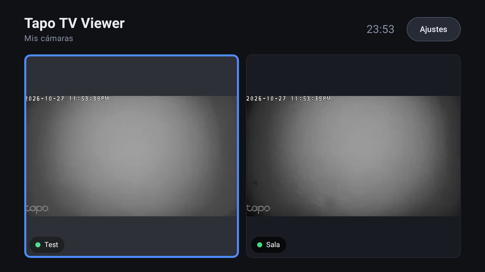

# Tapo Camera Viewer

Visores **solo para red local (LAN)** de cámaras TP-Link Tapo (probado con **Tapo C110**) usando su flujo RTSP, sin nube y sin exponer nada a Internet.

*[English summary](README.en.md)*

| Componente | Carpeta | Qué es |
|---|---|---|
| Visor web | [`web-viewer/`](web-viewer/) | Página en el navegador (WebRTC) servida localmente con [go2rtc](https://github.com/AlexxIT/go2rtc). |
| App Android TV | [`android-tv/`](android-tv/) | **Tapo TV Viewer**: cuadrícula de cámaras en el televisor, RTSP directo con Media3/ExoPlayer. |

## Características

**App Android TV**
- Cuadrícula al abrir; pantalla completa con OK, cambio de cámara con ←/→.
- Cuadrícula con el sub‑stream (ligero) y pantalla completa con el stream principal (HD).
- Cámaras configurables: nombre, IP, puerto, usuario, contraseña y rutas de stream. Las credenciales se guardan cifradas (`EncryptedSharedPreferences`).
- Personalización: título, descripción, color de acento, columnas, calidad, reloj, nombres, audio.
- Multilenguaje: español e inglés (sigue el idioma del sistema o se elige en Ajustes).
- Mantiene la pantalla encendida (evita el protector de pantalla) mientras la app está abierta.
- Aviso (sin límite duro) al configurar 4 o más cámaras.

**Visor web**
- Todas las cámaras definidas en `go2rtc.yaml` en una cuadrícula, con Pausa y Recargar.
- Escucha solo en `127.0.0.1`.

## Inicio rápido

1. Crea la **Cuenta de cámara** en cada cámara y fija su IP → [docs/configurar-camaras.md](docs/configurar-camaras.md)
2. Elige:
   - Visor web → [docs/visor-web.md](docs/visor-web.md)
   - App para TV → [docs/app-android-tv.md](docs/app-android-tv.md)

## Documentación

- [Configurar las cámaras Tapo](docs/configurar-camaras.md)
- [Visor web](docs/visor-web.md)
- [App Android TV (compilar e instalar)](docs/app-android-tv.md)
- [Seguridad](docs/seguridad.md)
- [Solución de problemas](docs/solucion-problemas.md)

## Seguridad en una línea

Todo el tráfico y las credenciales se quedan en tu red. **No** abras el puerto 554 ni el del visor en el router. Para ver las cámaras desde fuera usa una VPN. Detalles en [docs/seguridad.md](docs/seguridad.md).

## Limitaciones

- Solo visualización en vivo; no hay grabación ni reproducción de la tarjeta SD (decisión de diseño).
- Cámaras con batería (C410, C420, D230…) no ofrecen RTSP continuo y no son compatibles.
- Probado con 2 cámaras C110 y un Xiaomi MiTV (Android 10); otros equipos deberían funcionar pero no están verificados.

## Licencia

[MIT](LICENSE) © 2026 SmartGenius. go2rtc (descargado por separado) tiene su propia licencia (MIT).
