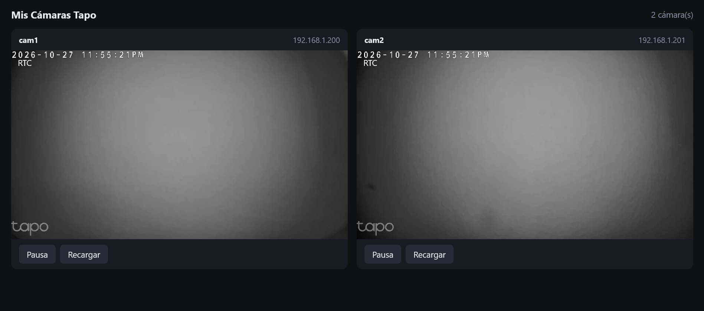

# Visor web

Servidor local basado en [go2rtc](https://github.com/AlexxIT/go2rtc) (un solo ejecutable). Requiere Windows + PowerShell (go2rtc también existe para Linux/macOS; adapta los scripts).

## Instalación

```powershell
cd web-viewer
.\descargar-go2rtc.ps1     # baja bin\go2rtc.exe
.\configurar.ps1           # pregunta nº de cámaras, nombre, IP y la Cuenta de cámara
.\iniciar.ps1              # abre http://localhost:1984/ y arranca go2rtc
```

`configurar.ps1` crea `go2rtc.yaml` (contiene credenciales, está en `.gitignore`). También puedes copiar `go2rtc.yaml.example` y editarlo a mano.



## Uso

- Cada cámara que aparezca en `streams:` se muestra en la cuadrícula.
- **Pausa/Play** y **Recargar** por cámara.
- Si el navegador muestra datos viejos tras cambiar la configuración: `Ctrl+Shift+R`.

## Red

- La API/web escucha solo en `127.0.0.1:1984` (únicamente ese PC). Para verlo desde otro dispositivo de la LAN cambia `listen` a `":1984"` **sabiendo que cualquiera en tu red podrá ver las cámaras** (la API no tiene autenticación; go2rtc admite `username`/`password` bajo `api:`).
- WebRTC usa el puerto UDP/TCP 8555 en la LAN.
- El servidor RTSP de go2rtc está desactivado.
